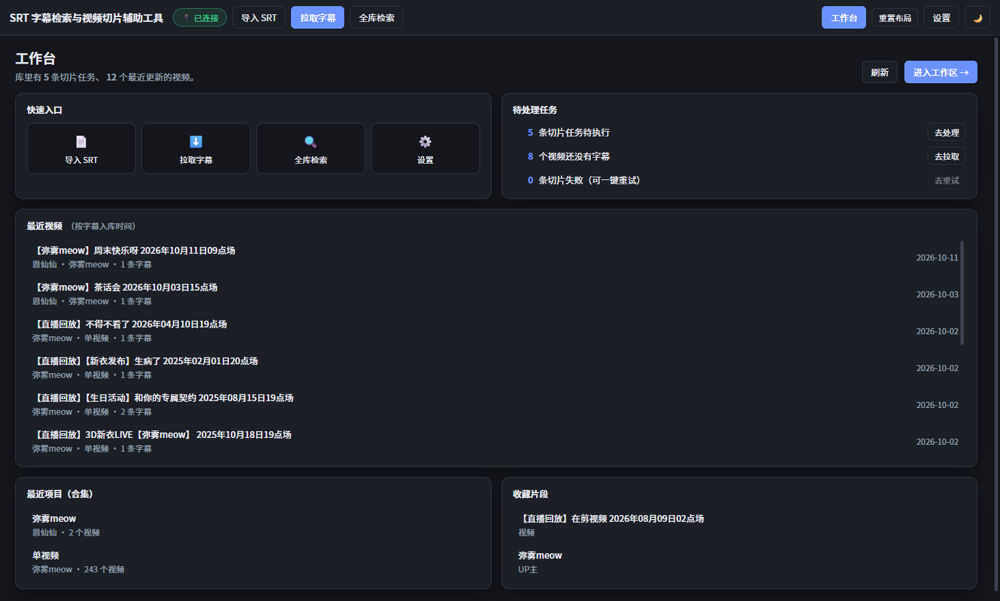

# 字幕剪 SubClip

> **基于字幕检索的 B站视频智能切片工作台** · 搜字幕，选片段，一键剪视频。

> 原名「SRT 字幕检索与视频切片辅助工具」，3.4.0 起更名为「字幕剪 / SubClip」。

[English](README.en.md) | 简体中文

桌面端字幕处理工具。围绕「**Bilibili 视频 → 获取字幕 → 字幕检索 → 选择片段 → 自动生成时间坐标 → 批量切片 → 输出视频片段**」这条工作流，覆盖「字幕检索 + 时间坐标生成 + 切片表导出 + **本机直接切片**」全流程，无需浏览器扩展参与。

对应需求文档：[`docs/requirements.md`](docs/requirements.md)（由原始 `.docx` 转换而来，末尾附「与实现的对照」）

---

## 重构升级进度（2.0 路线图）

按 [`SRTTool_2.0_重构升级执行提示词.md`](../SRTTool_2.0_重构升级执行提示词.md) 分九阶段推进。
**每完成一个阶段，本表与 `CHANGELOG.md` 同步更新，版本号一起走** —— 版本规划是
`0.1.0（起点）→ 1.5.0（第一阶段）→ 1.6.0（第二阶段）→ 2.0.0（第四阶段）→ 3.0.0（第八阶段）`。

> **九阶段已全部完成**（见下表）。`3.3.0` 起进入**第二轮：「字幕剪 / SubClip」产品重构**
> （依据《字幕剪（SubClip）产品逻辑重构与 UI/UX 全面升级》提示词），进度看下面这张表。

### 产品重构进度（3.3.0 起）

| 批次 | 内容 | 版本 | 说明 |
| --- | --- | --- | --- |
| 一 | **产品审计** + 三项点名改造 | `3.3.0` | 审计基于真实代码（20 组件 / 12 store / 81 IPC）；改造：①预览播放入口（原来**完全播不了**）②标题规范为「日期 UP主 内容」③多P 默认展开 |
| 二 | **产品更名 + 数据目录迁移** | `3.4.0` | SRT 字幕检索与视频切片辅助工具 → **字幕剪 / SubClip**；包名、appId、数据目录、插件名同步；**扩展 ID 不变**（插件不用重装） |
| 三 | **设计系统 Token + 全局导航重构** | `3.5.0` | 补全间距/字号/字重/控件高度/图标/层级/禁用态 Token；顶栏拆成「导航 + 动作 + 工具」三分区；导航改**纯切换语义**；新增「剪辑任务」一级页 |
| 四 | **数据模型拆表**：`clips`（片段）+ `export_jobs`（任务） | `3.6.0` | 一表三义拆开；任务带状态/进度/产物/错误；失败可重试；**「清空任务」不再删掉片段**；老库自动迁移（已实测） |
| 五 | **右栏瘦身 + 切片执行搬到剪辑任务页** | `3.7.0` | 右栏只留「当前选择 + 片段」；任务状态由执行过程维护（不再停在「排队中」）；切片改按**队列**驱动；剪辑任务页加执行条与进度 |
| 六 | **素材库工作区重做** | `3.8.0` | 命名对齐（工作区→素材库）；去掉与 store 重复的筛选状态；**树内可搜字幕正文**（标题命中优先，无命中才用正文兜底）；**视频预览可收起**，字幕阅读占满中栏 |
| 七 | **字幕检索页重做** | `3.9.0` | 补页头（标题 + 命中摘要）；结果工具条移到列表正上方并加实时「已选 N」；修「加入切片任务只刷新片段、不刷新队列」的缺陷；样式全改 token |
| 八 | **片段库页重做 + 页面骨架提取** | `3.10.0` | 页签按业务阶段重命名（推荐→发现、知识图谱→探索、发布素材包→素材包）；页头/页签回归设计系统；`.view-head`/`.stage-tabs` 提取为共享骨架（三个一级页面统一）；样式 token 化 |
| 九 | **工作台重做** | `3.11.0` | 页头并入共享骨架；修「片段数当成待执行任务数」与「去重试跳素材库」两个拆表遗留错误；挂载补齐 clip/jobs 两个 store；样式 token 化。**阶段五-3 五个页面至此全部重做完成** |
| 十 | **工作台重做** | `3.11.0` | 页头并入共享骨架；修「片段数当成待执行任务数」与「去重试跳素材库」两个拆表遗留错误；挂载补齐 clip/jobs 两个 store；样式 token 化。**阶段五-3 五个页面至此全部重做完成** |
| 十一 | **截图与验收**（阶段六） | `3.12.0` | 五个页面逐页截图（`docs/验收截图/`）做视觉核验；修内部阶段标记泄漏、片段库重复搜索框；`dist:dir` 打包通过、asar 完整 |
| 十二 | **全局 UI 视觉精修** | `3.13.0` | 重建中性配色（深色近纯黑、浅色近纯白）；**弱化几乎所有边框**（按钮/输入框/面板/弹窗去描边，分割线降到极低对比度）；选中态统一为「浅底 + 主色文字」；正文改系统 UI 字体优先；顺手修掉两个未定义的 CSS 变量（`--muted` / `--hover`）。截图存于 `docs/视觉精修/` |

| 阶段 | 内容 | 状态 | 版本 | 关键改动 | 涉及文件 |
| --- | --- | --- | --- | --- | --- |
| **一** | 项目基础整理与架构稳定化：状态管理重构 + 事件通信层 | ✅ 完成 | `1.5.0` | 状态从单个 1106 行模块拆成 7 个 Pinia store；新增 mitt 事件总线与 IPC 事件统一层；旧 `store.ts` 保留为兼容门面，组件零改动 | 新增 `src/renderer/src/bus.ts`、`src/renderer/src/stores/*`（7 个）；改写 `src/renderer/src/store.ts`、`main.ts`；`package.json` 加 `pinia` / `mitt` |
| **二** | 全新 UI 工作台：Dashboard 首页 + 四栏工作区 + 视频预览 | ✅ 完成 | `1.6.0` | 新增工作台首页；中栏拆成「预览上 / 字幕下」可拖拽；HTML5 Video 预览支持**点字幕即跳转**（主进程注入 Referer 直连 CDN） | 新增 `src/main/media.ts`、`components/DashboardView.vue`、`components/VideoPreview.vue`、`stores/video.ts`；改 `App.vue`、`styles.css`、`index.html`（CSP）、`db.ts`、`ipc.ts`、`preload`、`shared/types.ts` |
| **三** | 素材库系统升级：数据模型（作者 / 片段 / 分析结果）+ 标签体系 + 片段库 | ✅ 完成 | `1.7.0` | 片段=带名称/标签/收藏的时间范围，新增「片段库」视图；标签加颜色备注与双计数、支持批量打标；新增作者与分析结果表；全部走补列迁移 | 新增 `components/ClipsView.vue`、`stores/tags.ts`；改 `db.ts`（4 张新表 + 5 个新列 + 迁移）、`ipc.ts`、`preload`、`stores/clip.ts`、`ClipPanel.vue`、`DashboardView.vue`、`TagDialog.vue`、`App.vue` |
| **四** | 搜索系统升级：FTS5 全文搜索 + 语义搜索（混合模式） | ✅ 完成 | `1.8.0` / `2.0.0` | 全文检索：排序权重（标题 > 文件名 > 正文）、四类筛选、分页与命中数截断；语义检索：本地 BGE-small-zh + worker 推理 + 自动排队建索引（断点续跑） | 改 `db.ts`（`searchCuesPage` + 段落/向量表）、`ipc.ts`、`preload`；新增 `src/main/embed/*`（下载 / worker / 引擎）、`stores/semantic.ts`、`SearchView.vue` 双模式 |
| **五** | 视频剪辑工作流：时间轴 / 自动命名 / 批量剪辑 | 🟡 上半完成（时间轴与智能命名已做；批量剪辑本就具备） | `2.1.0` | canvas 时间轴（拖选即勾选、分P 分界）；按内容自动命名（剥语气词、保留实词）；「智能命名」批量改名 | 新增 `components/TimelineBar.vue`、`shared/timeline.ts`、`shared/clipTitle.ts`、`shared/filename.ts`；改 `SubtitleReader.vue`、`ClipPanel.vue`、`ipc.ts`、`preload`、`stores/clip.ts` |
| **六** | AI 能力层：`AIProvider`（摘要 / 标签 / 语义搜索 / 标题 / 分析字幕） | ✅ 完成 | `2.2.0` | 双后端（本地 Ollama / OpenAI 兼容）；五个能力全部落地；结果落 `analysis` 表；AI 生成 + 人审核；默认关闭 | 新增 `src/main/ai/*`、`components/AiPanel.vue`、`stores/ai.ts`、`tests/fake-openai.mjs`；改 `ipc.ts`、`preload`、`SettingsView.vue`、`SubtitleReader.vue`、`ClipPanel.vue`、`diagnostics.ts` |
| — | 打包链路验证 + 产物瘦身（非功能阶段） | ✅ 完成 | `2.2.1` / `2.3.0` | `npm run dist:dir` 实测通过，**打包产物里语义检索真能跑**；排除非 win32 二进制与 wasm 变体后 **736.9MB → 468.6MB** | 改 `electron-builder.yml`、`README.md`、`CHANGELOG.md` |
| **七** | 插件系统升级：JSON 消息协议 `{version, type, payload}` | ✅ 完成 | `2.4.0` / `2.5.0` | 协议升到 **v5**：每条消息带 `v` 与 `caps`，两端 `serialize` 自动补；能力表驱动协商（取代「只比版本号」）；设置页显示每条连接的协议版本与能力标签；版本倒挂时界面明确提示；**老插件照旧放行** | 改 `shared/bridge.ts`、`main/bridge.ts`、`main/wire.ts`、`preload`、`stores/ipcEvents.ts`、`bus.ts`、`SettingsView.vue`、`extension/shared/protocol.js`、`extension/background.js`、`extension/README.md`、`tests/fake-plugin.mjs` |
| 八 | 高级创新：AI 素材推荐、视频知识图谱、剪辑模板系统 | ✅ 完成 | `2.6.0`~`2.9.0` | 素材推荐与知识图谱**全部本地**（本地向量 + `Intl.Segmenter` 分词），不需要外部模型：推荐分「跨视频同主题 / 本片高光 / 本片代表段落」；图谱分「主题 → 视频 → 观点 → 片段」四层；**剪辑模板**把发布文案骨架沉淀成可复用模板（`{token}` 占位符 + 列表展开 + 话题标签），一键用当前视频填充 | 新增 `shared/recommend.ts`、`shared/extract.ts`、`shared/copyTemplate.ts`、`main/recommend.ts`、`main/graph.ts`、`components/RecommendView.vue`、`GraphView.vue`、`TemplateView.vue`、`videos.centroid` 列、`topics`/`video_topics`/`viewpoints`/`copy_templates` 表、`recommend:*`+`graph:*`+`template:*` IPC；改 `db.ts`、`ipc.ts`、`preload`、`types.ts`、`ClipsView.vue`、`stores/subtitle.ts` |
| 九 | 最终产品形态：内容发布 / 成片导出 | ✅ 完成 | `3.0.0` / `3.1.0` / `3.2.0` | ① **发布素材包**：标题 / 简介 / 标签 / 分镜表 / 每条片段的字幕稿 / 切片清单，导出成文件夹；② **成片拼接**：多条片段（可跨视频）先各自切片再按顺序拼成一条 mp4，带进度与取消，`-c copy` 失败自动回退重编码，同名不覆盖、中间产物自动清理；③ **模板 → 素材包一键联动**（标题/正文/标签自动拆好带过去） | 新增 `shared/publishKit.ts`、`main/publishKit.ts`、`main/compose.ts`、`components/KitView.vue`、`stores/publish.ts`、`kit:*`+`compose:*` IPC、`splitForPublish()`；改 `ipc.ts`、`preload`、`ClipsView.vue`、`TemplateView.vue` |

### 第一阶段（1.5.0）改了什么，为什么

阶段目标不是加功能，而是把「功能越加越不敢改」这件事解决掉。

| 决策点 | 选项 | 采用 | 原因 |
| --- | --- | --- | --- |
| 状态管理 | A 方案 Pinia 模块化 / B 拆分现有 store 文件 / C 先拆 3 个 | **A** | 后面 AI、知识图谱、时间轴都要挂新状态，直接一步到位；Vue3 生态原生 |
| 事件通信 | mitt + IPC 统一事件层 / 只做 IPC 层 / 先不做 | **mitt + IPC 统一事件层** | UI 内部解耦用 mitt，插件与切片这类主进程推送统一收敛到一处 |
| 兼容策略 | 一次性改完所有组件 / 保留门面逐步迁移 | **保留门面** | 十来个组件全改的风险是「漏一处就白屏」；门面让每个阶段都能保持可运行 |
| 版本号 | 每阶段 +0.1 / 按提示词里程碑 | **按提示词里程碑** | 与文档的 V1.5 / V2.0 / V3.0 规划对齐，阶段成果一眼可辨 |

拆出来的 store 与职责边界（**改哪块只动哪个文件**）：

| store | 负责 | 明确不负责 |
| --- | --- | --- |
| `stores/settings.ts` | `AppSettings` 单例、主题与阅读样式副作用 | 任何业务请求 |
| `stores/ui.ts` | 视图切换、提示条、插件连接状态、拉取与切片进度 | 持久化数据 |
| `stores/resource.ts` | 资源树、展开 / 筛选、可整棵撤销的删除 | 当前打开的文档正文 |
| `stores/subtitle.ts` | 当前文档与全部字幕轨、勾选、光标、文档内搜索、双语对照、编辑撤销栈、时间范围推导 | 切片任务、全库检索 |
| `stores/clip.ts` | 切片任务 / 历史、本机切片执行、ffmpeg 检测 | 时间范围怎么来的 |
| `stores/search.ts` | 全库检索（FTS5）、命中勾选、批量加入切片任务 | 当前文档内搜索 |
| `bus.ts` | 应用级事件类型与 `emit` / `on` | 不存数据，只做通知 |
| `stores/ipcEvents.ts` | 主进程推送 → 事件总线 + store 的**唯一**接线处 | 业务逻辑 |

> 兼容门面 `src/renderer/src/store.ts` 保留了拆分前**完全一致**的对外 API
> （`state` 用 Proxy 做属性级转发、setter 也实现了）。所以本次改动对组件是透明的，
> 后续哪个组件有空就把它改成直接 `useXxxStore()`，全部迁完即可删掉门面。

**第一阶段的验证方式**（可复现）：`npm run typecheck`、`npm test` 全绿；
再用 `npm run dev -- -- --remote-debugging-port=9222` 起应用，配 `node tests/shot.mjs` 实机走过
「全库检索 → 勾选命中 → 批量加入切片任务 → 打开命中跳转定位 → 阅读区勾选推时间范围」这条链路。

### 第二阶段（1.6.0）改了什么，为什么

| 决策点 | 选项 | 采用 | 原因 |
| --- | --- | --- | --- |
| 视频预览内核 | HTML5 Video / mpv·VLC / 先不做 | **HTML5 Video** | 零新依赖、不打包内核；`<video>` 不支持的头（如部分 HEVC）先如实报错 |
| 播放地址来源 | 复用切片模块 DASH / 另写一套 playurl / 只用本地文件 | **复用切片模块** | 同一个 `getPlayInfo`（含 WBI 签名回退）已稳定，预览与切片共用一套画质设置 |
| 布局 | 预览上/字幕下 / 四栏等宽 / 浮窗画中画 | **素材库 · （预览上/字幕下）· 剪辑助手** | 字幕跟读需要「画面在上、文本在下」的纵向呼应；预览高度可拖拽调 |
| 首页 | 组件卡片 / 插件化 Dashboard / 最小版 | **组件卡片** | 首页只有 5 块固定内容，插件化要额外定义模块注册协议，收益不成比例 |

**第二阶段的验证方式**：`npm test` 204 项全通过；实机走
「全库检索 → 打开命中 → 预览出画面（1920×1080 / 4599s）→ 勾选第 846 条（00:44:49）
→ 播放器自动跳到 2689.1s」；首页五张卡片与「点最近视频进工作区」均正常。

### 第三阶段（1.7.0）改了什么，为什么

| 决策点 | 选项 | 采用 | 原因 |
| --- | --- | --- | --- |
| 数据模型 | 新建七张表 / 在现有表上增量扩展 / 只做有用的一部分 | **增量扩展** | 现有 `uploaders/collections/videos/docs/cues/clips/tags` 已承载 245 视频 / 489 字幕；按提示词那样重建等于全库迁移。新增的只有 `creators` / `video_creators` / `clip_tags` / `analysis` 四张表与 5 个新列，全部走补列迁移 |
| 智能标签 | 只做手动 / 现在接 AI / 本地规则推荐 | **只做手动**（AI 留阶段六） | 提示词的混合模式（AI 生成 + 人审核）依赖 `AIProvider`，那是第六阶段；本轮把标签的颜色/备注/批量打标/双计数做扎实，数据层同时把 `analysis` 表留好 |
| 片段定义 | 时间范围收藏 / 切片产物档案 / 两者都要 | **时间范围收藏** | 与现有 `clips` 表天然同构，不需要新表、不需要同步两份数据；「执行切片」是另一个动作（右栏队列） |

**「片段」与「切片任务」的关系**（这一阶段最容易混淆的点）：

| 视角 | 在哪看 | 能做什么 |
| --- | --- | --- |
| 素材 | 顶栏「**片段库**」 | 命名、打标签、收藏、筛选、跳回原片 |
| 待执行队列 | 右栏「**选择结果 / 切片任务**」 | 排序、导出 CSV/XLSX、本机切片、看历史 |

两者是**同一批数据**（`clips` 表）的两个动作，不存在「先转成任务才能执行」这一步。

### 第四阶段上半（1.8.0）：全文检索体验

| 改动 | 说明 |
| --- | --- |
| 排序权重 | 标题命中（3）> 字幕文件名命中（2）> 正文命中（1），同级按入库时间；结果左侧标出命中位置 |
| 命中范围 | 关键词同时匹配**正文 / 视频标题 / 字幕文件名**（此前只匹配正文，搜视频标题等于搜不到） |
| 筛选 | 标签（多选）/ 只看收藏 / 入库时间范围 / 单条字幕时长范围，全部下推 SQL |
| 分页 | 每页 100 条 + 「加载更多」；命中总数统计到 5000 截断，界面显示「5000+」并提示加筛选 |
| 短词 | 查询 < 3 字符仍自动回退 LIKE（trigram 索引要求至少 3 字符） |

**第四阶段下半（语义搜索）已完成（2.0.0）**：检索页顶部可在「关键词」与「按意思」之间切换。
语义检索用本地模型 `bge-small-zh-v1.5`（约 23MB，首次使用需下载）：

| 步骤 | 在哪做 |
| --- | --- |
| ① 下模型 | 设置 → 语义检索 → 下载模型（或检索页切到「按意思」后点下载） |
| ② 建索引 | 设置 → 语义检索 → 开始建索引（后台排队跑，可暂停/继续；关掉应用下次接着跑） |
| ③ 搜索 | 检索页 →「按意思」→ 输入一整句话 → 按意思搜 |

> **为什么需要「放宽 TLS 校验」**：本机直连 huggingface.co 会因证书链不全失败；
> 镜像 hf-mirror 的大文件又会被 302 到同样校验不过的域名。所以下载那一步需要用户明确授权放行
> （只影响模型下载这一条连接，不影响其它网络请求），或者手动把模型文件放进设置页显示的目录。
>
> **索引粒度**：同一分P 内按 45 秒窗口合并成「段落」，不是每条字幕一个向量 ——
> 10 万条字幕切完仍是 10 万段，而按窗口合并后数量少一个数量级，检索精度几乎无损。

**第三阶段的验证方式**：`npm test` 208 项全通过；实机在真实库上验证片段迁移、改名、收藏、标签颜色与筛选。
**第四阶段上半的验证方式**：`npm test` 211 项全通过；实机验证「高光 26 条 → 时长筛选 14 条 → 清除恢复 26 条」与「加载更多 100→200 条」。
**第四阶段下半的验证方式**：`npm test` 212 项全通过；实机验证模型下载（23.4MB）、切分 103365 段、
建索引持续推进，以及**索引未完成时**搜「怎么把长视频剪成短视频」仍能返回相似段落（最高 0.491）并正确标记结果不完整。

---

## 界面

**工作台首页**（`1.6.0` 起）：打开应用先看全貌 —— 最近视频、最近项目（合集）、收藏片段、
待处理任务（切片任务 / 还没字幕的视频 / 切片失败）与四个快速入口。



**工作区**：左「资源树」/ 中上「视频预览」+ 中下「字幕阅读」/ 右「选择结果与切片任务」。
勾选字幕即自动算出时间范围；打开字幕会自动解析播放地址，**点某条字幕播放器就跳到那一刻**
（预览栏的「跟随」按钮可关掉这个联动）。


**全库检索**：一次搜遍库里所有视频 / 分P 的字幕，命中可直接批量加入切片任务。


**字幕工具**：批量查找替换（支持正则）、时间轴平移 / 倍速、导出 SRT·VTT·TXT、复制带时间戳的链接。


---

## 一、已实现范围

### Phase 1：字幕读取、展示、搜索、选择、时间计算 ✅

| 需求（文档章节） | 实现情况 |
| --- | --- |
| 3.1 本地 SRT 上传 | 支持多选导入；自动识别 **UTF-8 / UTF-8-BOM / UTF-16 / GBK**；容错解析（缺序号、坐标后缀、样式标签、CRLF、异常时间轴均不中断，收集为告警） |
| 3.1 字幕获取工具整合 | 由主进程重写 B 站字幕接口（见下），无需依赖该 Python 工具即可拉取字幕 |
| 3.2 字幕浏览 | 编号 / 开始时间 / 结束时间 / 文本四列；滚动、当前行高亮、自动定位、搜索上下处定位；双击行进入**正文编辑**（说明：早期文档写的是「双击跳转」，实际行为是编辑） |
| 3.3 搜索 | 文本搜索 + 关键词高亮 + 上下处定位 + 「选中全部匹配」 |
| 3.4 字幕选择 | 复选框；单击 / Shift 单击连续选择 / Ctrl 全选 / 反选 / 清除；支持非连续、多段选择 |
| 3.5 时间坐标生成 | 连续字幕合并为一段（首条开始 → 末条结束）；非连续生成多个独立范围；支持「合并间隔」阈值 |
| 6 UI 设计 | 左（视频资源树）/ 中（字幕阅读区）/ 右（选择结果与切片任务）三栏；资源树支持搜索、**分类（自定义标签）**、收藏、删除（删错了可用顶部的「撤销删除」整棵恢复，含正文、标签与切片任务）；字幕区支持字体、行距、深色模式 |
| 7 设置页 | 字幕显示、快捷键说明、路径设置（含目录存在性检测）、通信端口、B站 Cookie 登录检测、数据统计 |
| — | 说明：需求文档里的「字幕获取工具目录」已**移除**。该设置只做目录存在性探测、不参与任何功能（字幕获取逻辑早已由主进程重写内置），留着只会让新用户以为装坏了。 |

### Phase 2：连接批量切片工具 ✅

| 需求（文档章节） | 实现情况 |
| --- | --- |
| 3.6 切片工具连接 | 已阅读 `D:\subtitle2clip\bilibili-slice-downloader` 源码，其输入是一张表格（`BV号 / 分P / 开始时间 / 结束时间 / 备注(文件名)`）。本工具按该格式**生成 CSV / XLSX**，导出后直接在切片扩展里导入即可批量下载 |

### Phase 3：浏览器插件 + 本地通信 ✅

| 需求（文档章节） | 实现情况 |
| --- | --- |
| 4.1 页面检测 | 插件识别 **视频页 / 合集页 / 收藏夹 / 投稿页**，提取视频ID、标题、URL、UP主信息 |
| 4.2 桌面端同步 | 本地 WebSocket（桌面端作服务端，仅监听 `127.0.0.1:8765`），含握手、心跳保活、断线指数退避重连 |
| 4.3 字幕获取 | 插件调 B 站接口抓取字幕（**复用浏览器登录态，无需填 Cookie**），推送给桌面端自动入库。桌面端会按 BV 号补齐视频信息（真实 UID / 合集），所以插件推来的字幕**一次就落到正确的 UP主 分组**，不需要先点「同步该视频」 |
插件安装与使用见 [`extension/README.md`](extension/README.md)。

#### 本地服务的安全模型（重要）

WebSocket 握手**不受 CORS 约束** —— 只绑 `127.0.0.1` 挡得住外部主机，**挡不住本机网页**：
用户访问的任何一个页面都能向 `ws://127.0.0.1:8765` 发起连接。所以本地服务自带三道闸门：

| 闸门 | 作用 |
| --- | --- |
| **Origin 白名单** | 只放行固定 ID 的自家扩展（`manifest.json` 的 `key` 字段把扩展 ID 钉死为 `lmchilpnlhdfbpjklnfpfgkbddcdekpl`）。来源不符时回一条说明并立即断开，不给任何数据 |
| **逐类型消息校验** | 所有入站消息都要过 `parseClientMessage`：BV 号格式、时间必须是有限数、字幕条数与字符串长度都有上限，超限一律丢弃 |
| **maxPayload + 速率限制** | 单帧上限 512 KB（`ws` 默认是 100 MiB，一条畸形帧就能打爆主进程内存）；单连接每秒消息数超限即断开 |

另外提供**可选的配对令牌**（设置 → 浏览器插件通信）：生成随机串后，插件必须在握手时带上同样的值才能提交数据。
默认留空 —— 来历不明的网页已经过不了 Origin 白名单，令牌主要用来防「本机其它程序伪造 Origin」这类更边缘的情况。

> 渲染进程也不被无条件信任：主进程只读写「用户本人在系统对话框里选过的路径」，
> 「打开」按钮限制在应用自己的几个目录内，并拒绝可执行扩展名。
> **拖拽导入是个例外，但它自己把关**：只接受扩展名在白名单内（`.srt` / `.vtt` / `.txt`）、
> 真实存在且是普通文件的路径，通过后才登记为已批准 —— 即便渲染进程被注入也读不到任意本地文件。

### Phase 4：UI 打磨、自定义快捷键、虚拟滚动、正文编辑 ✅

| 需求（文档 7 / 9） | 实现情况 |
| --- | --- |
| 超大字幕文件的虚拟滚动 | 支持**动态行高**的虚拟滚动，只渲染可见区域 + 缓冲；实测 5000 条字幕仅渲染 23 行，滚动定位、搜索跳转均准确 |
| 字幕正文编辑 | 双击行 / `F2` / 行内 ✎ 按钮进入编辑；`Enter` 保存、`Shift+Enter` 换行、`Esc` 取消；改完即写回磁盘 |
| 自定义快捷键 | 设置页可视化录制，按 Esc 取消录制；支持**冲突检测**与单项 / 全部重置 |
| 阅读条 | 屏幕偏上位置（列表高度 38%）有一条阅读条，滚动时最接近它的一条字幕会**放大突出**并高亮，跟随滚动平滑过渡；滚轮被改成**一次一行**的步进；可在工具栏或设置中开关 |
| 多分P 连续阅读 | 同一视频的多个分P 字幕首尾相接连续展示，分界处有醒目的 `P2 · 标题` 标签 |
| 双语对照 | 同一视频有多条字幕轨（例如中文原文 + 英文翻译）时，工具栏出现「对照」下拉，可选另一条轨并排显示。同一分P 内优先按原始序号对齐，序号对不上时按时间重叠匹配；分P 不同不对照 |
| 跨分P 切片 | 若 Pn 的**最后一条**与 Pn+1 的**第一条**都被选中，两段会合并成**同一个切片**，切片时分别裁剪再按顺序合成一个视频 |
| UI 打磨 | 三栏面板宽度**可拖拽**并记住；底部状态栏（总数 / 已选 / 段数 / 匹配数 / 当前文档）；统一的圆角、阴影与悬停反馈；深浅色主题；窄窗口自适应 |
| 拖拽导入 | 把 `.srt` / `.vtt` / `.txt` 拖进窗口即可导入（可一次多个），带整窗遮罩提示；路径校验在主进程做 |
| 右键菜单 | 资源树节点：展开/折叠、收藏、重命名、打标签、删除；字幕行：复制这句话、复制带时间戳链接、编辑正文、勾选、用这一条新建切片任务 |
| 无障碍 | 资源树是标准 `tree`/`treeitem`（含 `aria-level` / `aria-expanded` / `aria-selected`），可用 Enter/空格打开、左右键收放、`F2` 重命名；字幕列表是 `listbox`/`option`；三个面板是 `navigation`/`main`/`complementary` 地标；图标按钮都有 `aria-label`；提示条是 `aria-live`；`:focus-visible` 焦点圈；尊重「减少动态效果」偏好 |
| 细节 | 界面文本默认**不可选中**，避免 Shift 连选时出现蓝色选区 |

### 补充：桌面端也能独立获取字幕

主进程用 Node 原生 `fetch` 重写了 `bili_subtitle_extension_native_v1.2.8/native_host/bilibili_api.py` 的核心逻辑，**不依赖 Python**：

- `x/web-interface/view` → 视频标题 / UP主 / 分P / 所属合集
- `x/web-interface/nav` → 取 **WBI 签名** 密钥（含 `mixinKeyEncTab` 重排 + MD5 签名）
- `x/player/wbi/v2` → 字幕轨列表（失败自动回退老接口 `x/player/v2`）
- 字幕 JSON → `Cue[]`，落库归入「UP主 → 合集 → 视频 → 字幕」层级

### 归类规则（不管字幕从哪来，都走同一套）

层级固定是 **UP主 → 合集 → 视频 → 字幕**，关键在于「谁算同一个 UP主」和「什么算同一份字幕」：

| 规则 | 说明 |
| --- | --- |
| **UP主 身份只认 UID** | B站接口里的 `owner.mid` 就是 UID。桌面端拉取、插件推送、本地导入三条路拿到的 UID 相同时，一定进同一个 UP主 分组。昵称改了不会分裂成两个分组。 |
| **本地导入也尽量归位** | 填了 BV 号（或文件名里带 BV 号）→ 拉取视频信息，归到真实 UP主 / 合集 下；确实拿不到才进「本地导入 / 本地文件」。 |
| **插件推送到陌生视频时会先查一次** | 本地没有这个 BV 号时，桌面端先自己查一次视频信息拿到真实 UID，字幕**一次就落到正确分组**，不需要先手动点「同步该视频」。 |
| **查不到时的兜底会自愈** | 未登录 / 断网 / 接口异常时，字幕先落到「未关联 / 来自浏览器插件」占位；之后补上页面信息，视频会自动归位，空掉的占位分组会被清理（资源树本身也不显示空分组）。 |
| **没有 BV 号的推送直接丢弃** | 早期版本会为此建一个 `bvid` 为空的条目，之后所有无 BV 号的推送都挤进那同一个垃圾条目；现在直接丢弃并提示。 |
| **没有具体视频的页面不落库** | 合集页 / 收藏夹 / 投稿页同步过来时不再建空条目（以前会产出一堆空视频）。 |
| **字幕去重键 = 视频 + 分P + 语言** | 同一条字幕轨重复拉取 / 重复推送时**原地覆盖**，不再越点越多；不同语言各自保留，所以缺失语言仍然能补齐。 |

---

## 二、技术栈

- **Electron 33** + **Vue 3** + **Vite**（`electron-vite` 构建）
- **TypeScript** 全量类型覆盖，主/预加载/渲染三端共享类型（`src/shared`）
- **状态管理**：**Pinia**（按域拆成 10 个 store，见「重构升级进度」）+ **mitt** 事件总线（UI 内部解耦）
- **视频预览**：HTML5 Video 直连 B站 CDN，主进程注入 Referer（`src/main/media.ts`）
- **语义检索**：`@huggingface/transformers` + BGE-small-zh，推理在 worker 线程（`src/main/embed/`）
- **数据存储**：**SQLite**（用 Electron 内置的 `node:sqlite`，零原生依赖，不需要 MSVC 工具链）
  > 早期版本是「单文件 JSON + 每个文档一个正文 JSON」。换成 SQLite 的原因：每次写操作都要重写整个文件，
  > 批量拉字幕时放大得厉害；文件一坏全库皆失；而且没法做跨文档全文检索。
  > 现在字幕正文直接入库，并带一个 FTS5 索引支撑全库检索。
  > **老数据会自动迁移**：首次启动读到旧的 `srt-tool.json` 就导入进去（含旧目录里的正文文件），
  > 完成后把原文件改名成 `srt-tool.json.migrated-<时间戳>` 留档，不删除。
- **表格导出**：CSV（带 UTF-8 BOM，Excel 打开不乱码）+ XLSX（SheetJS）

---

## 三、目录结构

```
app/
├── src/
│   ├── shared/                 # 三端共享
│   │   ├── types.ts            # 数据模型与接口类型
│   │   ├── constants.ts        # 端口 / 目录名等常量
│   │   ├── time.ts             # 时间解析 / 格式化（内部统一用秒）
│   │   ├── ranges.ts           # 时间坐标生成算法
│   │   ├── naming.ts           # 切片任务命名模板（纯函数）
│   │   ├── cues.ts             # 字幕合并 / 拆分（纯函数）
│   │   ├── shortcuts.ts        # 快捷键动作表与解析
│   │   └── bridge.ts           # 插件通信协议（与 extension/shared/protocol.js 对应）
│   ├── main/                   # Electron 主进程
│   │   ├── index.ts            # 应用入口、窗口创建
│   │   ├── ipc.ts              # IPC 注册（薄封装 + 路径白名单）
│   │   ├── services.ts         # 业务逻辑（可独立测试）
│   │   ├── bridge.ts           # 本地 WebSocket 服务端（Origin 校验 / 令牌 / 限流）
│   │   ├── wire.ts             # 插件事件 → 业务处理 的接线
│   │   ├── db.ts               # 数据层（SQLite + FTS5，含老数据迁移）
│   │   ├── srt.ts              # SRT 解析 / 生成 / 编码识别 / 批量编辑
│   │   ├── bilibili.ts         # B站接口（WBI 签名 / 字幕）
│   │   ├── media.ts            # 视频预览：解析 DASH 流 + 给 CDN 请求注入 Referer
│   │   ├── embed/              # 语义检索（第四阶段）
│   │   │   ├── download.ts     # 模型下载（可只对这条连接放宽 TLS 校验）
│   │   │   ├── worker.cjs      # 推理 worker（transformers.js，CPU）
│   │   │   └── engine.ts       # 段落切分 / 排队建索引 / 暴力余弦检索
│   │   ├── ai/                 # AI 能力层（第六阶段）
│   │   │   ├── prompts.ts      # 提示词与结构化结果解析（纯函数，可单测）
│   │   │   └── provider.ts     # 双后端（Ollama / OpenAI 兼容）+ 五个能力
│   │   ├── exporter.ts         # 切片表 CSV / XLSX 导出
│   │   ├── clipIO.ts           # 切片任务 JSON 导入导出（逐条校验，坏数据只跳过）
│   │   ├── diagnostics.ts      # 诊断信息组装与脱敏（纯函数，便于单测）
│   │   ├── slice/              # 本地切片（playurl / sidx / downloader / ffmpeg / engine / filename）
│   │   └── settings.ts         # 设置持久化
│   ├── preload/index.ts        # contextBridge 暴露 window.api
│   └── renderer/src/
│       ├── App.vue             # 布局 + 快捷键
│       ├── store.ts            # 状态门面（转发到 stores/*，拆完可删）
│       ├── bus.ts              # 应用内事件总线（mitt）与事件类型表
│       ├── stores/             # 按域拆分的 Pinia store
│       │   ├── settings.ts     # 设置 / 主题 / 阅读样式
│       │   ├── ui.ts           # 视图 / 提示条 / 插件连接 / 进度
│       │   ├── resource.ts     # 资源树 / 展开筛选 / 可撤销删除
│       │   ├── subtitle.ts     # 当前文档 / 勾选 / 文档内搜索 / 对照 / 撤销栈
│       │   ├── clip.ts         # 片段 / 切片任务、历史、本机切片
│       │   ├── search.ts       # 全库检索
│       │   ├── tags.ts         # 标签（颜色 / 备注 / 批量打标）
│       │   ├── video.ts        # 视频预览会话 / 播放位置 / 跟随联动
│       │   ├── semantic.ts     # 语义检索（模型 / 索引进度 / 结果）
│       │   ├── ai.ts           # AI 能力层（状态 / 摘要 / 标签建议 / 逐句解释）
│       │   └── ipcEvents.ts    # 主进程推送 → 总线 + store 的唯一接线处
│       ├── styles.css          # 主题变量（浅色 / 深色）
│       └── components/
│           ├── ResourceTree.vue    # 左侧资源树
│           ├── TreeNodeItem.vue    # 递归树节点
│           ├── DashboardView.vue   # 工作台首页（最近视频 / 项目 / 收藏 / 待办）
│           ├── VideoPreview.vue    # 视频预览（HTML5 Video + 独立音轨对齐）
│           ├── ClipsView.vue       # 片段库（命名 / 标签 / 收藏 / 定位回原片）
│           ├── TimelineBar.vue     # 时间轴（canvas：拖选即勾选、分P 分界）
│           ├── AiPanel.vue         # AI 助手（摘要 / 标签建议 + 人审核）
│           ├── TagDialog.vue       # 给视频打标签
│           ├── ContextMenu.vue     # 通用右键菜单
│           ├── SubtitleReader.vue  # 中间字幕阅读区
│           ├── SearchView.vue      # 全库检索页
│           ├── EditToolsDialog.vue # 批量替换 / 时间轴 / 导出 / 复制
│           ├── ClipPanel.vue       # 右侧选择结果 / 切片任务
│           ├── SettingsView.vue    # 设置页
│           ├── ImportDialog.vue    # 导入 SRT
│           └── PullDialog.vue      # 拉取字幕（多场景链接）
├── extension/                  # 浏览器插件（Manifest V3）
│   ├── manifest.json
│   ├── background.js           # service worker：WebSocket 客户端 + 字幕抓取
│   ├── content.js              # B站页面检测与信息提取
│   ├── popup.html/.css/.js     # 弹出面板
│   ├── shared/protocol.js      # 通信协议
│   ├── shared/bilibili.js      # B站接口
│   └── README.md               # 插件安装与说明
└── tests/
    ├── core.test.ts            # 核心逻辑 + 快捷键 + 文件名净化 + 协议校验 + 导出/批量编辑 + 命名模板 + 任务 JSON + 对照对齐 + 合并拆分 + 诊断脱敏（96 项）
    ├── wbi.test.ts             # WBI 签名 / 协议 / 版本 / 扩展 ID 一致性（18 项）
    ├── sidx.test.ts            # 切片 SIDX 解析与区间计算（14 项）
    ├── smoke.ts                # 端到端 + 迁移 + 检索 + 撤销删除 + 标签 + 任务排序/历史 + 备份恢复（31 项）
    ├── bridge.smoke.ts         # 插件通信端到端 + 来源校验 / 配对令牌（27 项）
    ├── demo.srt                # 演示字幕
    ├── gen-large-srt.mjs       # 开发辅助：生成超大字幕文件
    ├── fake-plugin.mjs         # 开发辅助：模拟插件客户端
    └── shot.mjs                # 开发辅助：CDP 截图 / 求值
```

根目录下的其它文件：

| 文件 | 说明 |
| --- | --- |
| `README.md` / `README.en.md` | 中文 / 英文说明 |
| `docs/requirements.md` | 需求文档（由原始 `.docx` 转换），末尾附「与实现的对照」 |
| `docs/publishing.md` | 上传到 GitHub 后的发布清单（要替换的占位都在这里） |
| `docs/images/` | README 里用到的截图（1.6.0 起为当前界面，由 `tests/shot.mjs` 在真实应用中截取） |
| `LICENSE` | MIT |
| `THIRD-PARTY.md` | 随程序分发的依赖与移植代码的归属声明 |
| `SECURITY.md` | 安全模型与漏洞报告方式 |
| `CONTRIBUTING.md` | 开发约定与提交前检查清单 |
| `CHANGELOG.md` | 版本变更记录 |
| `electron-builder.yml` | 打包配置 |
| `.npmrc.example` | 国内 npm 镜像示例（可选，复制成 `.npmrc` 生效） |
| `build/make-icon.mjs` | 生成应用图标（可复现，不用二进制设计文件） |
| `build/make-extension-key.mjs` | 生成插件固定 ID 所需的公钥 |

---

## 四、安装与运行

需要 **Node.js 20 或以上**（开发环境用的是 22 / 24；Electron 36 自带 Node 22）。

```bash
git clone <仓库地址>
cd <clone 下来的目录>      # 仓库根就是这个 app/ 目录
npm install
npm run dev        # 开发模式（热更新）
npm run build      # 构建到 out/
npm run typecheck  # 类型检查（渲染进程 + 主进程 + 测试 + 插件脚本）
npm test           # 运行全部测试（96 + 18 + 14 + 31 + 27 项）
```

调试辅助：

```bash
# 模拟浏览器插件连接并推送页面信息与字幕
node tests/fake-plugin.mjs 8765

# 生成超大字幕文件（用于验证虚拟滚动），默认 5000 条
node tests/gen-large-srt.mjs 5000
```

> **关于 npm 镜像（可选）**：中国大陆网络直连 npm 与 GitHub Releases（Electron 二进制）通常很慢，
> 仓库提供了 `.npmrc.example`，复制成 `.npmrc` 即可走国内镜像：
>
> ```bash
> cp .npmrc.example .npmrc     # Windows: copy .npmrc.example .npmrc
> ```
>
> 之所以只提交示例而不是 `.npmrc` 本身：CI 跑在境外的 runner 上，用国内镜像反而更慢、还可能拉不到包，
> 所以镜像做成 opt-in，两边都不吃亏。
>
> **关于测试环境**：`test:smoke` 与 `test:bridge` 会真的启动 Electron 主进程，需要能创建窗口的桌面会话
> （纯 SSH / 无图形环境会失败），其余三组是纯 Node 测试，任何环境都能跑。

### 打包为安装包

```bash
npm run dist       # Windows 安装包（NSIS）+ 免安装版，输出到 dist/
npm run dist:dir   # 只解包、不生成安装包（验证打包配置时更快）
```

**打包链路已实测验证**（`2.2.1` 那轮）：产物能启动、语义检索能在打包版里真跑通
（worker 从 asar 加载模型，返回相似度 0.67 的结果）、时间轴与视频预览正常。

**产物已瘦身**（`2.3.0`）：**736.9MB → 468.6MB**。做法是在 `electron-builder.yml` 里排除
与 Windows 桌面运行无关的文件：

| 排除项 | 省下 | 原因 |
| --- | --- | --- |
| `onnxruntime-node/bin/napi-v6/darwin/**`、`linux/**` | 153.7MB | 只出 Windows 包 |
| `onnxruntime-web/dist/**` | 135.1MB | 走 Node 绑定，用不到 WASM 变体 |

> ⚠️ 两条**试错结论**（配置里有注释，别重复踩）：
> ① `onnxruntime-node` **不能整个去掉** —— transformers v4 的 Node 构建在 import 阶段就 require 它；
> ② `@img/sharp` **不能排** —— 排掉后语义检索报 `Could not load the "sharp" module`（实测）。
> 另外：**要出 macOS / Linux 包时必须把前两条排除规则去掉**，否则那些平台语义检索会失败。

> **Windows 打包前置条件**：electron-builder 会下载 `winCodeSign` 工具包，其中 macOS 的符号链接
> 需要「创建符号链接」权限。**未开启开发者模式且非管理员时解压会失败**，报
> `Cannot create symbolic link ... libcrypto.dylib`。二选一解决：
> 打开「设置 → 系统 → 开发者选项 → 开发人员模式」，或改用管理员终端执行。
> （GitHub Actions 的 windows runner 自带该权限，CI 里不受影响。）
>
> 产物结构：`dist/win-unpacked/` 就是免安装版，直接运行 `SRT Clip Helper.exe`；
> 浏览器插件被放在 `resources/extension/`（asar 之外），
> 「设置 → 浏览器插件通信 → 插件目录」指向的就是它。

---

## 五、使用流程

1. **准备登录状态**（拉取 B 站字幕必需，二选一）
   - **推荐**：在浏览器安装本项目的插件，连接后到插件弹窗点一次「同步登录状态到桌面端」—— 之后桌面端就能自己拉字幕，**完全不需要手动获取 Cookie**（连接时也会自动同步）。
   - 手动：在「设置 → B站账号 → 手动填写 Cookie」粘贴浏览器的 Cookie。
2. **准备字幕**（二选一）
   - **从浏览器插件拉**：在 B站 视频页点插件弹窗的「**让桌面端拉取全部分P**」——
     插件只把 BV 号告诉桌面端，抓取由桌面端完成，所以**不管你在第几个分P 点，都会拉这个视频的全部分P**。
     进度显示在桌面端顶部。
   - **在浏览器里浏览合集 / 收藏夹 / UP主投稿页时**：插件会把「你正在看哪个合集」告诉桌面端，
     桌面端**自动打开拉取对话框并列出该合集的所有视频**，你逐条确认要拉哪些即可
     （同一合集只会自动问一次，避免翻页时反复弹窗）。
   - 顶部「**拉取字幕**」：粘贴**视频 / 合集 / 系列 / 收藏夹 / UP主主页 / b23.tv 短链**，或直接输入 BV 号 → 解析出视频列表 → 勾选要拉取的视频 → 一键批量拉取。
     - **拉取的最小单位是视频**：勾选一个视频即自动抓取它**全部分P** 的字幕（有多少抓多少）。
     - **按「分P + 语言」去重**：本地已有的字幕轨不会重复拉，缺失的语言会补齐。也就是说同一个视频先有 AI 字幕、后来出了人工字幕，再拉一次就能补上，而不会把 AI 字幕又存一份。
   - 顶部「**导入 SRT**」：选择本地字幕文件。
     - 填了 BV 号 → 拉取视频信息，归到**真实的 UP主 / 合集**下（和插件推送、桌面端拉取同一套分组）。
     - 没填 → 会先尝试**从文件名里识别 BV 号**，识别到就归到对应视频；识别不到才归入「本地导入 / 本地文件」。
     - 同一个文件重复导入只会**原地更新**，不会堆出重复字幕。
   - 也可以把 `.srt` / `.vtt` / `.txt` **直接拖进窗口**（可一次拖多个），效果与「导入 SRT」相同。
3. **检索**（两种粒度）
   - **当前文档内**：中部搜索框（`Ctrl+F`）输入关键词，`↑`/`↓` 按钮逐处定位，可一键选中全部匹配。
   - **整个字幕库**（`Ctrl+Shift+F` 或顶栏「全库检索」）：一次搜遍库里所有视频 / 分P 的字幕，
     结果列表带上下文与关键词高亮；点任意一条会打开对应文档并**精确跳到那一句**；
     可以勾选多条**批量加入切片任务**（每条命中就是一个时间范围）。范围可限定为「当前视频」或「当前分组」。
4. **选择**：勾选字幕行；`Shift+单击` 连续选择；`Shift+↑/↓` 扩展选择；`Enter` 切换当前行。
   在任意字幕行上**右键**可复制这句话 / 复制带时间戳链接 / 编辑正文 / 用这一条直接建切片任务；
   在资源树节点上右键可展开、收藏、重命名、打标签、删除。
5. **修订字幕**（可选）：阅读区工具栏点「**字幕工具**」，可做
   - **批量查找替换**：支持正则与忽略大小写；
   - **时间轴调整**：整体平移（±毫秒）或倍速缩放；
   - **导出** SRT / WebVTT / 纯文本（可勾选「包含该视频全部分P」合成一份）；
   - **复制**：复制选中字幕文本，或复制**带分P 与时间戳的 B站链接**（粘进浏览器直接跳到那一刻）。
   在字幕行上**右键**还能**合并 / 拆分**：勾选 ≥2 条后右键「合并选中的 N 条」（中文直接连、英文自动补空格），
   或右键「从 X 秒处拆成两条」。改错了用工具栏「**撤销**」（`Ctrl+Z`）/「**重做**」（`Ctrl+Y`）。
6. **生成时间坐标**：右侧自动显示时间范围（连续合并、非连续分段），可调整「合并间隔」。
7. **加入切片任务** → 填备注前缀 → 右侧列表可见，可单条删除或清空。
8. **切片**（二选一）
   - **本机直接切片**（推荐）：点右下角「**本地切片**」，工具会解析 DASH 分片索引、只下载目标片段、调用 ffmpeg 裁剪合成 mp4，全程在本机完成，无需浏览器插件参与。
   - **导出表格给浏览器扩展**：点「导出 CSV / XLSX」，再到 Edge 扩展《B站表格批量切片下载器》里导入执行。

> **多分P 连续阅读**：同一视频的多个分P 字幕会首尾相接成一个连续列表，中间用醒目的> 分P 标签（如 `P2 · 标题`）标出分界，可以一路读下去，不必来回切换文档。
>
> **阅读条**：屏幕偏上位置有一条阅读条，滚动时最接近它的那条字幕会放大突出并平滑跟随，方便跟读。

---

### 补充：AI 能力层（2.2.0 起）

**AI 是增强功能，默认关闭**；关掉时字幕、检索、切片、时间轴全部照常工作。

| 能力 | 在哪用 | 说明 |
| --- | --- | --- |
| 摘要 | 右侧「AI 助手」面板 | 对该视频**全部字幕**生成 3~5 句摘要；结果落库，重开直接读缓存 |
| 标签建议 | 同上 | AI 给候选 + 理由，**默认只勾「库里还没有的」**，勾完保存才写入库（AI 生成 + 人审核） |
| AI 标题 | 片段列表每条右侧 🤖 | 用该片段的字幕生成标题并写入片段名（规则命名仍是默认） |
| 逐句解释 | 字幕行右键「AI 解释这句话」 | 带上下文解释，按句落库，再点直接读缓存 |
| 云端语义打分 | 代码层 `ai:rank` | 没建本地语义索引时的替代路线（把候选文本发到云端打分） |

**两种后端**（设置 → AI 能力层）：

- **本地 Ollama**（推荐）：装好 Ollama 后 `ollama pull qwen2.5:7b`，面板上会列出本机已有模型；
- **任何 OpenAI 兼容接口**：填 base URL（一般以 `/v1` 结尾）+ API Key + 模型名，
  OpenAI / DeepSeek / 智谱 / vLLM / LM Studio 都行。

> 用云端接口时**字幕内容会发给你配置的服务**（这一点在设置页有明确提示）；
> 生成结果只存在本地数据库。**API Key 只存本机设置文件，且不会出现在导出的诊断信息里**
> （与 Cookie / 配对令牌同级脱敏，有单测锁住）。

**没有真模型也能验证 AI 链路**：`node tests/fake-openai.mjs 8877` 会起一个最小 OpenAI 兼容假服务
（按协议真实应答，所以请求构造、超时、响应解析、JSON 容错都会被执行到），
把后端设成 OpenAI 兼容、base URL 填 `http://127.0.0.1:8877/v1` 即可。
> 别用 8765 —— 那是本应用自己的插件 WebSocket 端口。

### 补充：时间轴与智能命名（2.1.0 起）

**时间轴**在字幕阅读区上方，把整段视频压成一条横轴：

- **拖出一段 → 范围内的字幕自动被勾选**（与列表复选框是同一份选择，不会两边对不上）；
- `Shift` 拖动 = 追加；单击 = 跳到那一刻（光标与播放器一起走）；
- 跨分P 阅读时轴上有 **`P1` `P2` 分界线**——时间轴是各分P 首尾相接的，
  不标出来就不知道拖到的这段属于哪一 P，而切片结果完全取决于这个；
- 拖动时右下角实时显示「起点 → 终点 · N 条」，松手后提示会汇总分P 数与时间跨度。

**智能命名**（规则版，AI 优化留到第六阶段）：加入切片任务时，片段名取该范围第一条
**有信息量**的字幕，并剥掉开头语气词：

| 字幕 | 生成的片段名 |
| --- | --- |
| `诶我真的很喜欢那个眼神` | `我真的很喜欢那个眼神` |
| `不是就是B站嗯` | `不是就是B站嗯`（「不是」是实词，剥掉会改变语义，所以保留） |
| `哦对了` / `嗯` / `。。。` | 往后找下一条；都没有才回退「视频标题 + 序号」 |

右侧面板的「**智能命名**」按钮可以把已有片段按内容批量重命名 —— 早先加的任务名字都是
`前缀 #1`，点一下就会变成有内容的名字（名称与输出文件名是两回事，见「片段库」一节）。

### 补充：批量剪辑

「一次选多个片段 → 输出 clip001 / clip002 / …」这条链路本来就通：
**选多个范围 → 加入切片任务 → 命名模板的 `{index}` 递增 → 本机切片按序输出**。
配合上面的时间轴，现在可以「拖一段、再拖一段」，然后一次性切完。

### 补充：片段库（1.7.0 起）

顶栏「**片段库**」把切片任务的另一面做出来 —— 同一批数据，换个视角管理素材：

- **片段 = 带名称、标签、收藏状态的时间范围**。卡片显示所属视频、作者、时间轴、来源与标签。
- **命名**：点 / 双击片段名即可改（如「开场钩子」「名场面」）。
  名称与**输出文件名**是两回事：改名不会动产物文件名，后者仍按「设置 → 本地切片 → 任务命名模板」渲染。
- **标签**：与视频共用同一套标签（可就地勾选）；标签本身支持颜色与备注。
- **收藏**：点卡片右上角 ☆；收藏的片段会出现在工作台首页的「收藏片段」里。
- **定位**：点「定位」跳回这条片段对应的字幕位置，播放器也会跟过去。
- **筛选**：按关键词 / 来源（手动 · 检索 · 切片）/ 标签 / 只看收藏。

> 右栏那份「切片任务」列表是**待执行队列**（排序、导出、切片），片段库是**素材管理**
> （命名、打标、收藏、回找）。两者不是两种数据，也不需要在它们之间「转换」。

### 补充：视频预览（1.6.0 起）

打开一个字幕文档后，中栏上半部分会自动解析该分P 的播放地址并出画面（解析需要几秒）：

- **点某条字幕 / 按 ↑↓ 移动光标，播放器就跳到那一刻** —— 跟读时不用自己拖进度条；
  不想要这个联动就点预览栏的「**跟随**」关掉（本会话内有效）。
- 预览栏的「**同步**」按钮：立即把播放器对齐到当前光标那条字幕。
- 音轨是 DASH 独立文件，所以画面与声音由两个元素播放并自动对齐；默认**静音**，点 🔇 开声音。
- 跨分P 的字幕：光标移到别的分P 时会自动重新解析那个分P 的流。
- 没有 BV 号的纯本地字幕无法预览（会明确说明，不会假装在加载）。

> **为什么预览要连 CDN**：B站 DASH 地址校验 `Referer`，而 `<video>` 不允许自定义该请求头。
> 所以由主进程给**去往 CDN 的请求**注入 `Referer / UA / Origin`（只对已解析出的播放地址生效），
> 播放器直连 CDN、自己发 Range 请求。详见 `src/main/media.ts`。
> 会员专享 / 地区限制的视频需要先在「设置 → B站账号」配置登录状态。

---

## 六、本地切片（内置，替代浏览器扩展）

原工具 `bilibili-slice-downloader` 是 Edge 扩展，靠 ffmpeg.wasm 在浏览器里切片。现在这套能力已**移植进桌面端**，不需要浏览器扩展参与：

| 原扩展的实现 | 桌面端实现 |
| --- | --- |
| `x/player/playurl` 取 DASH 流 | 同上，并复用桌面端已有的 WBI 签名设施（`src/main/slice/playurl.ts`） |
| 解析 SIDX box 得到「时间 ↔ 字节」映射 | 同逻辑，TS 重写（`src/main/slice/sidx.ts`），并补了单元测试 |
| Range 分片并发下载 | Node `fetch` + `Buffer`，按体积自动定并发（`downloader.ts`） |
| ffmpeg.wasm 裁剪合成 | 调用**原生 ffmpeg**（`ffmpeg.ts`），速度快很多 |

**关键优化**：不是下载整段视频再裁剪，而是先读 SIDX 索引，算出目标时间段对应的**字节区间**，只下载这一小段。切 10 秒片段通常只需下载几 MB。

### 切片任务管理与历史

右侧面板分「任务」与「历史」两个页签：

| 能力 | 说明 |
| --- | --- |
| **任务排序** | 每条任务左侧的 ▲/▼ 调整顺序，顺序会持久化（`clips.sort_order`） |
| **任务改名** | 双击备注即可改名 —— 备注就是切片输出的文件名 |
| **JSON 导入 / 导出** | 把整份任务列表存成 JSON 或从 JSON 追加导入。解析时**逐条校验**，坏数据只跳过并告警，不整份拒绝 |
| **命名模板** | 设置 → 本地切片 → 任务命名模板，支持 `{prefix}` `{index}` `{bvid}` `{page}` `{start}` `{end}` `{duration}` `{title}` |
| **切片历史** | 每次跑完记录逐条结果（成功 / 失败 / 已取消、输出路径、错误原因）；成功项可直接打开输出文件 |
| **重试失败** | 一键把历史里失败或被取消的任务重新加回任务列表，不必回去重新勾字幕 |

### 依赖：ffmpeg

本地切片需要 ffmpeg（本机原本没有）。三种方式任选：

1. 在「设置 → 本地切片」点**选择…**，指定已有的 `ffmpeg.exe`
2. 点右上角**获取 ffmpeg** 打开下载页，解压后把 `bin\ffmpeg.exe` 路径填进去
3. 把 `ffmpeg.exe` 放到 `%APPDATA%\srt-clip-helper\bin\` 下，会自动识别

设置页会实时显示检测结果。未就绪时切片按钮会给出提示并引导过去。

### 可调参数

- **切片画质**：360P ~ 4K（受账号权限限制会自动降级；未登录通常也能拿到 1080P）
- **下载并发数**：1~8（网络并行度，越大越快但更容易被限速）
- **切片输出目录**：留空则用「切片表输出目录」

---

## 七、快捷键

全部快捷键均可在 **设置 → 快捷键** 中自定义（点击按键按钮后直接按下新组合键）。

| 默认按键 | 功能 |
| --- | --- |
| `Ctrl + F` | 聚焦当前文档的搜索框 |
| `Ctrl + Shift + F` | 打开 / 关闭全库检索 |
| `↑` / `↓` | 上下移动当前字幕行 |
| `Shift + ↑` / `Shift + ↓` | 从锚点扩展选择范围 |
| `Enter` | 勾选 / 取消当前字幕 |
| `F2` | 编辑当前字幕正文 |
| `Ctrl + A` | 全选字幕 |
| `Esc` | 清除选择（在搜索框中则清空内容） |
| `Ctrl + Enter` | 把当前时间范围加入切片任务 |
| `Ctrl + E` | 导出 CSV 切片表 |
| `Ctrl + Z` | 撤销最近一次字幕编辑 |
| `Ctrl + Y` | 重做刚被撤销的编辑 |

鼠标操作：`Shift + 单击` 连续选择一段；双击行进入编辑。

---

## 八、数据位置

| 内容 | 路径 |
| --- | --- |
| 资源 / 字幕 / 切片任务数据 | `%APPDATA%\srt-clip-helper\srt-tool-data\srt-tool.db`（SQLite，附带 `-wal` / `-shm`） |
| 旧版数据（迁移后留档） | 同目录 `srt-tool.json.migrated-<时间戳>` 与 `docs\<docId>.json` |
| 应用设置 | `%APPDATA%\srt-clip-helper\settings.json` |
| 切片表输出 | 默认 `我的文档\subtitle-clips`，可在设置里改 |

### 备份与恢复（设置 → 数据）

- **备份数据库**：把整库导出成**单个** `.db` 文件（走 SQLite 的 `VACUUM INTO`，
  连 WAL 里尚未落盘的内容一起带上，也不依赖 `-wal` / `-shm` 边车文件），拷到别的机器就能用。
- **从备份恢复**：恢复前会先把当前库另存为 `srt-tool.db.before-restore-<时间戳>`，
  恢复失败（文件不是 SQLite、或内容不可用）会**自动回滚**，不会把已有数据弄丢。
- **导出诊断信息**：版本、运行时版本、系统、统计、各路径是否存在、配置项与插件连接状态。
  **Cookie 与配对令牌只记录「是否配置」与长度，绝不写内容**（有单测锁住这一点），报 bug 时附上它最有用。
- **清空全部数据**：需要二次确认，不可撤销（建议先备份）。

---

## 九、已知限制

- **B 站接口**：非公开稳定 API，站点改版后可能需要更新 `src/main/bilibili.ts` 与 `extension/shared/bilibili.js`。仅处理当前账号有权访问的字幕，不绕过付费 / 私密 / 地区限制。
- **插件页面选择器**：B 站前端改版可能导致 `extension/content.js` 的 DOM 选择器失效，届时需同步更新。UP主 UID 读不到时，该条会先按昵称分组，补上页面信息后才会并到真实 UP主 下。
- **插件协议版本**：当前为 **v4**（v2 把 UP主 字段 `uploader.mid` 改为 `uploader.uid`；v3 加入握手来源校验与配对令牌，并收紧消息校验；v4 新增 `pull-request`）。桌面端兼容旧的 `mid` 字段名，但**改了协议记得两边一起更新**（`src/shared/bridge.ts` ↔ `extension/shared/protocol.js`），`npm run test:wbi` 会校验版本号与扩展 ID 一致。
  > 桌面端对**不认识的消息类型是静默丢弃**的，所以插件靠 `hello-ack` 里的 `protocol` 做能力协商；
  > 协议版本落后时插件会明确提示「请更新桌面端」，而不是假装发送成功。
- **推送陌生 BV 号时会多一次接口调用**：本地没有该 BV 号时需要先查一次视频信息才能归对分组；未登录 / 断网时会退化成「未关联」占位，之后可自动归位。
- **MV3 保活**：service worker 被浏览器回收后，靠 `chrome.alarms` 每分钟唤醒重连，极端情况下有约 1 分钟的重连空窗。
- **批量编辑**：已支持**批量查找替换（可开正则、可忽略大小写）**、**时间轴整体平移 / 倍速缩放**、
  **字幕合并 / 拆分**，并带**撤销 / 重做**（`Ctrl+Z` / `Ctrl+Y`，内存里各保留最近 20 步）。
  尚未提供的是「跨文档批量替换」与「可视化逐条拖拽调轴」。
- **数据规模**：SQLite + FTS5，十万条量级字幕下检索与滚动都不成问题；超大单文档（十万条以上）首次打开仍会有可感知的读取延迟。
- **本地切片的依赖**：需要 ffmpeg（工具不自带，需自行指定或安装）；老视频若只提供 `durl` 格式则不支持切片，会给出明确提示。
- **切片并发**：ffmpeg 处理是串行的（同一时刻只跑一个），并发只作用于网络下载阶段。

---

## 十、故障排查

**启动后报 `Cannot read properties of undefined (reading 'whenReady')`**

当前终端继承了 `ELECTRON_RUN_AS_NODE=1`（常见于 IDE / 宿主应用注入的环境变量），会让 Electron 退化为纯 Node 运行。清除该变量后再启动：

```bash
# Git Bash
env -u ELECTRON_RUN_AS_NODE npm run dev

# PowerShell
$env:ELECTRON_RUN_AS_NODE = $null; npm run dev
```

**拉取 B 站字幕提示「获取播放地址失败 / 字幕列表为空」**

多为未登录、会员专享或地区限制。请在浏览器登录 B 站后复制 Cookie 粘贴到设置页，再点「保存并检测登录状态」。

**导出的 CSV 在 Excel 里乱码**

本工具导出的 CSV 已带 UTF-8 BOM，正常情况不会乱码。若仍有问题，改用「导出 XLSX」。
