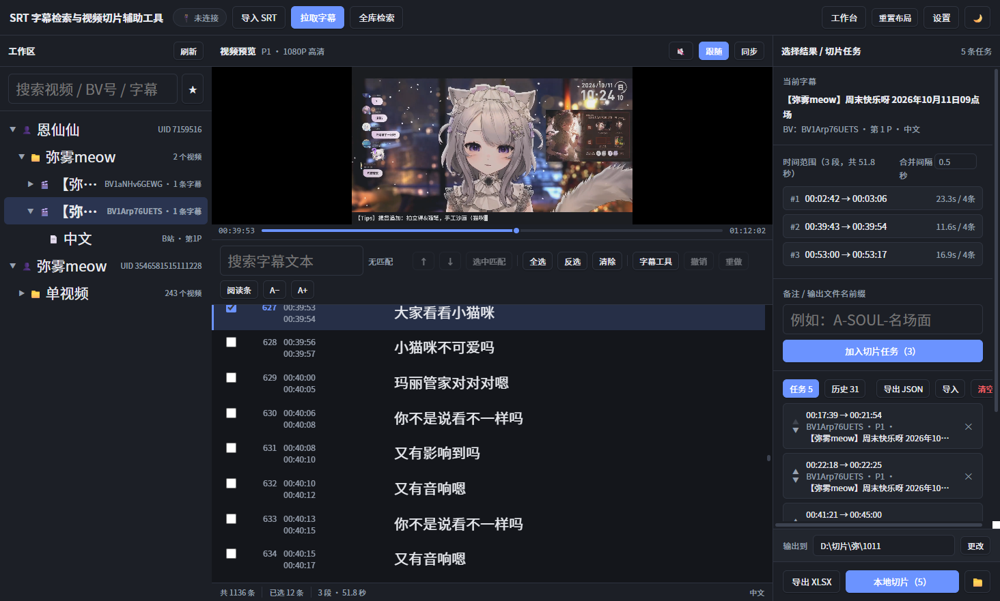
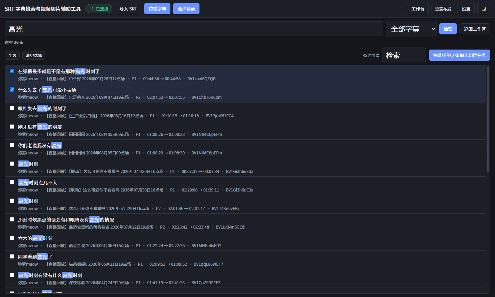
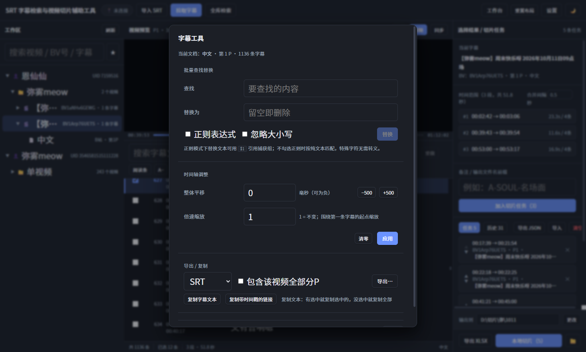

# SRT 字幕检索与视频切片辅助工具

[English](README.en.md) | 简体中文

桌面端字幕处理工具。围绕「**Bilibili 视频 → 获取字幕 → 字幕检索 → 选择片段 → 自动生成时间坐标 → 批量切片 → 输出视频片段**」这条工作流，覆盖「字幕检索 + 时间坐标生成 + 切片表导出 + **本机直接切片**」全流程，无需浏览器扩展参与。

对应需求文档：[`docs/requirements.md`](docs/requirements.md)（由原始 `.docx` 转换而来，末尾附「与实现的对照」）

## 界面

**工作区**：左「资源树」/ 中「字幕阅读」/ 右「选择结果与切片任务」。勾选字幕即自动算出时间范围。



**全库检索**：一次搜遍库里所有视频 / 分P 的字幕，命中可直接批量加入切片任务。



**字幕工具**：批量查找替换（支持正则）、时间轴平移 / 倍速、导出 SRT·VTT·TXT、复制带时间戳的链接。



---

## 一、已实现范围

### Phase 1：字幕读取、展示、搜索、选择、时间计算 ✅

| 需求（文档章节） | 实现情况 |
| --- | --- |
| 3.1 本地 SRT 上传 | 支持多选导入；自动识别 **UTF-8 / UTF-8-BOM / UTF-16 / GBK**；容错解析（缺序号、坐标后缀、样式标签、CRLF、异常时间轴均不中断，收集为告警） |
| 3.1 字幕获取工具整合 | 由主进程重写 B 站字幕接口（见下），无需依赖该 Python 工具即可拉取字幕 |
| 3.2 字幕浏览 | 编号 / 开始时间 / 结束时间 / 文本四列；滚动、当前行高亮、自动定位、搜索上下处定位；双击行进入**正文编辑**（说明：早期文档写的是「双击跳转」，实际行为是编辑） |
| 3.3 搜索 | 文本搜索 + 关键词高亮 + 上下处定位 + 「选中全部匹配」 |
| 3.4 字幕选择 | 复选框；单击 / Shift 单击连续选择 / Ctrl 全选 / 反选 / 清除；支持非连续、多段选择 |
| 3.5 时间坐标生成 | 连续字幕合并为一段（首条开始 → 末条结束）；非连续生成多个独立范围；支持「合并间隔」阈值 |
| 6 UI 设计 | 左（视频资源树）/ 中（字幕阅读区）/ 右（选择结果与切片任务）三栏；资源树支持搜索、**分类（自定义标签）**、收藏、删除（删错了可用顶部的「撤销删除」整棵恢复，含正文、标签与切片任务）；字幕区支持字体、行距、深色模式 |
| 7 设置页 | 字幕显示、快捷键说明、路径设置（含目录存在性检测）、通信端口、B站 Cookie 登录检测、数据统计 |
| — | 说明：需求文档里的「字幕获取工具目录」已**移除**。该设置只做目录存在性探测、不参与任何功能（字幕获取逻辑早已由主进程重写内置），留着只会让新用户以为装坏了。 |

### Phase 2：连接批量切片工具 ✅

| 需求（文档章节） | 实现情况 |
| --- | --- |
| 3.6 切片工具连接 | 已阅读 `D:\subtitle2clip\bilibili-slice-downloader` 源码，其输入是一张表格（`BV号 / 分P / 开始时间 / 结束时间 / 备注(文件名)`）。本工具按该格式**生成 CSV / XLSX**，导出后直接在切片扩展里导入即可批量下载 |

### Phase 3：浏览器插件 + 本地通信 ✅

| 需求（文档章节） | 实现情况 |
| --- | --- |
| 4.1 页面检测 | 插件识别 **视频页 / 合集页 / 收藏夹 / 投稿页**，提取视频ID、标题、URL、UP主信息 |
| 4.2 桌面端同步 | 本地 WebSocket（桌面端作服务端，仅监听 `127.0.0.1:8765`），含握手、心跳保活、断线指数退避重连 |
| 4.3 字幕获取 | 插件调 B 站接口抓取字幕（**复用浏览器登录态，无需填 Cookie**），推送给桌面端自动入库。桌面端会按 BV 号补齐视频信息（真实 UID / 合集），所以插件推来的字幕**一次就落到正确的 UP主 分组**，不需要先点「同步该视频」 |

插件安装与使用见 [`extension/README.md`](extension/README.md)。

#### 本地服务的安全模型（重要）

WebSocket 握手**不受 CORS 约束** —— 只绑 `127.0.0.1` 挡得住外部主机，**挡不住本机网页**：
用户访问的任何一个页面都能向 `ws://127.0.0.1:8765` 发起连接。所以本地服务自带三道闸门：

| 闸门 | 作用 |
| --- | --- |
| **Origin 白名单** | 只放行固定 ID 的自家扩展（`manifest.json` 的 `key` 字段把扩展 ID 钉死为 `lmchilpnlhdfbpjklnfpfgkbddcdekpl`）。来源不符时回一条说明并立即断开，不给任何数据 |
| **逐类型消息校验** | 所有入站消息都要过 `parseClientMessage`：BV 号格式、时间必须是有限数、字幕条数与字符串长度都有上限，超限一律丢弃 |
| **maxPayload + 速率限制** | 单帧上限 512 KB（`ws` 默认是 100 MiB，一条畸形帧就能打爆主进程内存）；单连接每秒消息数超限即断开 |

另外提供**可选的配对令牌**（设置 → 浏览器插件通信）：生成随机串后，插件必须在握手时带上同样的值才能提交数据。
默认留空 —— 来历不明的网页已经过不了 Origin 白名单，令牌主要用来防「本机其它程序伪造 Origin」这类更边缘的情况。

> 渲染进程也不被无条件信任：主进程只读写「用户本人在系统对话框里选过的路径」，
> 「打开」按钮限制在应用自己的几个目录内，并拒绝可执行扩展名。

### Phase 4：UI 打磨、自定义快捷键、虚拟滚动、正文编辑 ✅

| 需求（文档 7 / 9） | 实现情况 |
| --- | --- |
| 超大字幕文件的虚拟滚动 | 支持**动态行高**的虚拟滚动，只渲染可见区域 + 缓冲；实测 5000 条字幕仅渲染 23 行，滚动定位、搜索跳转均准确 |
| 字幕正文编辑 | 双击行 / `F2` / 行内 ✎ 按钮进入编辑；`Enter` 保存、`Shift+Enter` 换行、`Esc` 取消；改完即写回磁盘 |
| 自定义快捷键 | 设置页可视化录制，按 Esc 取消录制；支持**冲突检测**与单项 / 全部重置 |
| 阅读条 | 屏幕偏上位置（列表高度 38%）有一条阅读条，滚动时最接近它的一条字幕会**放大突出**并高亮，跟随滚动平滑过渡；滚轮被改成**一次一行**的步进；可在工具栏或设置中开关 |
| 多分P 连续阅读 | 同一视频的多个分P 字幕首尾相接连续展示，分界处有醒目的 `P2 · 标题` 标签 |
| 跨分P 切片 | 若 Pn 的**最后一条**与 Pn+1 的**第一条**都被选中，两段会合并成**同一个切片**，切片时分别裁剪再按顺序合成一个视频 |
| UI 打磨 | 三栏面板宽度**可拖拽**并记住；底部状态栏（总数 / 已选 / 段数 / 匹配数 / 当前文档）；统一的圆角、阴影与悬停反馈；深浅色主题；窄窗口自适应 |
| 细节 | 界面文本默认**不可选中**，避免 Shift 连选时出现蓝色选区 |

### 补充：桌面端也能独立获取字幕

主进程用 Node 原生 `fetch` 重写了 `bili_subtitle_extension_native_v1.2.8/native_host/bilibili_api.py` 的核心逻辑，**不依赖 Python**：

- `x/web-interface/view` → 视频标题 / UP主 / 分P / 所属合集
- `x/web-interface/nav` → 取 **WBI 签名** 密钥（含 `mixinKeyEncTab` 重排 + MD5 签名）
- `x/player/wbi/v2` → 字幕轨列表（失败自动回退老接口 `x/player/v2`）
- 字幕 JSON → `Cue[]`，落库归入「UP主 → 合集 → 视频 → 字幕」层级

### 归类规则（不管字幕从哪来，都走同一套）

层级固定是 **UP主 → 合集 → 视频 → 字幕**，关键在于「谁算同一个 UP主」和「什么算同一份字幕」：

| 规则 | 说明 |
| --- | --- |
| **UP主 身份只认 UID** | B站接口里的 `owner.mid` 就是 UID。桌面端拉取、插件推送、本地导入三条路拿到的 UID 相同时，一定进同一个 UP主 分组。昵称改了不会分裂成两个分组。 |
| **本地导入也尽量归位** | 填了 BV 号（或文件名里带 BV 号）→ 拉取视频信息，归到真实 UP主 / 合集 下；确实拿不到才进「本地导入 / 本地文件」。 |
| **插件推送到陌生视频时会先查一次** | 本地没有这个 BV 号时，桌面端先自己查一次视频信息拿到真实 UID，字幕**一次就落到正确分组**，不需要先手动点「同步该视频」。 |
| **查不到时的兜底会自愈** | 未登录 / 断网 / 接口异常时，字幕先落到「未关联 / 来自浏览器插件」占位；之后补上页面信息，视频会自动归位，空掉的占位分组会被清理（资源树本身也不显示空分组）。 |
| **没有 BV 号的推送直接丢弃** | 早期版本会为此建一个 `bvid` 为空的条目，之后所有无 BV 号的推送都挤进那同一个垃圾条目；现在直接丢弃并提示。 |
| **没有具体视频的页面不落库** | 合集页 / 收藏夹 / 投稿页同步过来时不再建空条目（以前会产出一堆空视频）。 |
| **字幕去重键 = 视频 + 分P + 语言** | 同一条字幕轨重复拉取 / 重复推送时**原地覆盖**，不再越点越多；不同语言各自保留，所以缺失语言仍然能补齐。 |

---

## 二、技术栈

- **Electron 33** + **Vue 3** + **Vite**（`electron-vite` 构建）
- **TypeScript** 全量类型覆盖，主/预加载/渲染三端共享类型（`src/shared`）
- **数据存储**：**SQLite**（用 Electron 内置的 `node:sqlite`，零原生依赖，不需要 MSVC 工具链）
  > 早期版本是「单文件 JSON + 每个文档一个正文 JSON」。换成 SQLite 的原因：每次写操作都要重写整个文件，
  > 批量拉字幕时放大得厉害；文件一坏全库皆失；而且没法做跨文档全文检索。
  > 现在字幕正文直接入库，并带一个 FTS5 索引支撑全库检索。
  > **老数据会自动迁移**：首次启动读到旧的 `srt-tool.json` 就导入进去（含旧目录里的正文文件），
  > 完成后把原文件改名成 `srt-tool.json.migrated-<时间戳>` 留档，不删除。
- **表格导出**：CSV（带 UTF-8 BOM，Excel 打开不乱码）+ XLSX（SheetJS）

---

## 三、目录结构

```
app/
├── src/
│   ├── shared/                 # 三端共享
│   │   ├── types.ts            # 数据模型与接口类型
│   │   ├── constants.ts        # 端口 / 目录名等常量
│   │   ├── time.ts             # 时间解析 / 格式化（内部统一用秒）
│   │   ├── ranges.ts           # 时间坐标生成算法
│   │   ├── naming.ts           # 切片任务命名模板（纯函数）
│   │   ├── shortcuts.ts        # 快捷键动作表与解析
│   │   └── bridge.ts           # 插件通信协议（与 extension/shared/protocol.js 对应）
│   ├── main/                   # Electron 主进程
│   │   ├── index.ts            # 应用入口、窗口创建
│   │   ├── ipc.ts              # IPC 注册（薄封装 + 路径白名单）
│   │   ├── services.ts         # 业务逻辑（可独立测试）
│   │   ├── bridge.ts           # 本地 WebSocket 服务端（Origin 校验 / 令牌 / 限流）
│   │   ├── wire.ts             # 插件事件 → 业务处理 的接线
│   │   ├── db.ts               # 数据层（SQLite + FTS5，含老数据迁移）
│   │   ├── srt.ts              # SRT 解析 / 生成 / 编码识别 / 批量编辑
│   │   ├── bilibili.ts         # B站接口（WBI 签名 / 字幕）
│   │   ├── exporter.ts         # 切片表 CSV / XLSX 导出
│   │   ├── clipIO.ts           # 切片任务 JSON 导入导出（逐条校验，坏数据只跳过）
│   │   ├── diagnostics.ts      # 诊断信息组装与脱敏（纯函数，便于单测）
│   │   ├── slice/              # 本地切片（playurl / sidx / downloader / ffmpeg / engine / filename）
│   │   └── settings.ts         # 设置持久化
│   ├── preload/index.ts        # contextBridge 暴露 window.api
│   └── renderer/src/
│       ├── App.vue             # 布局 + 快捷键
│       ├── store.ts            # 响应式状态与动作（含撤销栈、全库检索）
│       ├── styles.css          # 主题变量（浅色 / 深色）
│       └── components/
│           ├── ResourceTree.vue    # 左侧资源树
│           ├── TreeNodeItem.vue    # 递归树节点
│           ├── TagDialog.vue       # 给视频打标签
│           ├── SubtitleReader.vue  # 中间字幕阅读区
│           ├── SearchView.vue      # 全库检索页
│           ├── EditToolsDialog.vue # 批量替换 / 时间轴 / 导出 / 复制
│           ├── ClipPanel.vue       # 右侧选择结果 / 切片任务
│           ├── SettingsView.vue    # 设置页
│           ├── ImportDialog.vue    # 导入 SRT
│           └── PullDialog.vue      # 拉取字幕（多场景链接）
├── extension/                  # 浏览器插件（Manifest V3）
│   ├── manifest.json
│   ├── background.js           # service worker：WebSocket 客户端 + 字幕抓取
│   ├── content.js              # B站页面检测与信息提取
│   ├── popup.html/.css/.js     # 弹出面板
│   ├── shared/protocol.js      # 通信协议
│   ├── shared/bilibili.js      # B站接口
│   └── README.md               # 插件安装与说明
└── tests/
    ├── core.test.ts            # 核心逻辑 + 快捷键 + 文件名净化 + 协议校验 + 导出/批量编辑 + 命名模板 + 任务 JSON + 诊断脱敏（80 项）
    ├── wbi.test.ts             # WBI 签名 / 协议 / 版本 / 扩展 ID 一致性（18 项）
    ├── sidx.test.ts            # 切片 SIDX 解析与区间计算（14 项）
    ├── smoke.ts                # 端到端 + 迁移 + 检索 + 撤销删除 + 标签 + 任务排序/历史 + 备份恢复（31 项）
    ├── bridge.smoke.ts         # 插件通信端到端 + 来源校验 / 配对令牌（27 项）
    ├── demo.srt                # 演示字幕
    ├── gen-large-srt.mjs       # 开发辅助：生成超大字幕文件
    ├── fake-plugin.mjs         # 开发辅助：模拟插件客户端
    └── shot.mjs                # 开发辅助：CDP 截图 / 求值
```

根目录下的其它文件：

| 文件 | 说明 |
| --- | --- |
| `README.md` / `README.en.md` | 中文 / 英文说明 |
| `docs/requirements.md` | 需求文档（由原始 `.docx` 转换），末尾附「与实现的对照」 |
| `docs/images/` | README 里用到的截图 |
| `LICENSE` | MIT |
| `THIRD-PARTY.md` | 随程序分发的依赖与移植代码的归属声明 |
| `SECURITY.md` | 安全模型与漏洞报告方式 |
| `CONTRIBUTING.md` | 开发约定与提交前检查清单 |
| `electron-builder.yml` | 打包配置 |
| `build/make-icon.mjs` | 生成应用图标（可复现，不用二进制设计文件） |
| `build/make-extension-key.mjs` | 生成插件固定 ID 所需的公钥 |

---

## 四、安装与运行

需要 **Node.js 20 或以上**（开发环境用的是 22 / 24；Electron 36 自带 Node 22）。

```bash
git clone <仓库地址>
cd <clone 下来的目录>      # 仓库根就是这个 app/ 目录
npm install
npm run dev        # 开发模式（热更新）
npm run build      # 构建到 out/
npm run typecheck  # 类型检查（渲染进程 + 主进程 + 测试 + 插件脚本）
npm test           # 运行全部测试（80 + 18 + 14 + 31 + 27 项）
```

调试辅助：

```bash
# 模拟浏览器插件连接并推送页面信息与字幕
node tests/fake-plugin.mjs 8765

# 生成超大字幕文件（用于验证虚拟滚动），默认 5000 条
node tests/gen-large-srt.mjs 5000
```

> **关于 npm 镜像**：仓库里的 `.npmrc` 预设了国内镜像（registry / Electron 二进制走 npmmirror），
> 中国大陆网络下安装快很多；**海外网络请删掉或注释掉 `.npmrc` 再装**，否则会走弯路。
>
> **关于测试环境**：`test:smoke` 与 `test:bridge` 会真的启动 Electron 主进程，需要能创建窗口的桌面会话
> （纯 SSH / 无图形环境会失败），其余三组是纯 Node 测试，任何环境都能跑。

### 打包为安装包

```bash
npm run dist       # Windows 安装包（NSIS）+ 免安装版，输出到 dist/
npm run dist:dir   # 只解包、不生成安装包（验证打包配置时更快）
```

> **Windows 打包前置条件**：electron-builder 会下载 `winCodeSign` 工具包，其中 macOS 的符号链接
> 需要「创建符号链接」权限。**未开启开发者模式且非管理员时解压会失败**，报
> `Cannot create symbolic link ... libcrypto.dylib`。二选一解决：
> 打开「设置 → 系统 → 开发者选项 → 开发人员模式」，或改用管理员终端执行。
> （GitHub Actions 的 windows runner 自带该权限，CI 里不受影响。）
>
> 产物结构：`dist/win-unpacked/` 就是免安装版，直接运行 `SRT Clip Helper.exe`；
> 浏览器插件被放在 `resources/extension/`（asar 之外），
> 「设置 → 浏览器插件通信 → 插件目录」指向的就是它。

---

## 五、使用流程

1. **准备登录状态**（拉取 B 站字幕必需，二选一）
   - **推荐**：在浏览器安装本项目的插件，连接后到插件弹窗点一次「同步登录状态到桌面端」—— 之后桌面端就能自己拉字幕，**完全不需要手动获取 Cookie**（连接时也会自动同步）。
   - 手动：在「设置 → B站账号 → 手动填写 Cookie」粘贴浏览器的 Cookie。
2. **准备字幕**（二选一）
   - 顶部「**拉取字幕**」：粘贴**视频 / 合集 / 系列 / 收藏夹 / UP主主页 / b23.tv 短链**，或直接输入 BV 号 → 解析出视频列表 → 勾选要拉取的视频 → 一键批量拉取。
     - **拉取的最小单位是视频**：勾选一个视频即自动抓取它**全部分P** 的字幕（有多少抓多少）。
     - **按「分P + 语言」去重**：本地已有的字幕轨不会重复拉，缺失的语言会补齐。也就是说同一个视频先有 AI 字幕、后来出了人工字幕，再拉一次就能补上，而不会把 AI 字幕又存一份。
   - 顶部「**导入 SRT**」：选择本地字幕文件。
     - 填了 BV 号 → 拉取视频信息，归到**真实的 UP主 / 合集**下（和插件推送、桌面端拉取同一套分组）。
     - 没填 → 会先尝试**从文件名里识别 BV 号**，识别到就归到对应视频；识别不到才归入「本地导入 / 本地文件」。
     - 同一个文件重复导入只会**原地更新**，不会堆出重复字幕。
3. **检索**（两种粒度）
   - **当前文档内**：中部搜索框（`Ctrl+F`）输入关键词，`↑`/`↓` 按钮逐处定位，可一键选中全部匹配。
   - **整个字幕库**（`Ctrl+Shift+F` 或顶栏「全库检索」）：一次搜遍库里所有视频 / 分P 的字幕，
     结果列表带上下文与关键词高亮；点任意一条会打开对应文档并**精确跳到那一句**；
     可以勾选多条**批量加入切片任务**（每条命中就是一个时间范围）。范围可限定为「当前视频」或「当前分组」。
4. **选择**：勾选字幕行；`Shift+单击` 连续选择；`Shift+↑/↓` 扩展选择；`Enter` 切换当前行。
5. **修订字幕**（可选）：阅读区工具栏点「**字幕工具**」，可做
   - **批量查找替换**：支持正则与忽略大小写；
   - **时间轴调整**：整体平移（±毫秒）或倍速缩放；
   - **导出** SRT / WebVTT / 纯文本（可勾选「包含该视频全部分P」合成一份）；
   - **复制**：复制选中字幕文本，或复制**带分P 与时间戳的 B站链接**（粘进浏览器直接跳到那一刻）。
   改错了点工具栏「**撤销**」（`Ctrl+Z`）回退。
6. **生成时间坐标**：右侧自动显示时间范围（连续合并、非连续分段），可调整「合并间隔」。
7. **加入切片任务** → 填备注前缀 → 右侧列表可见，可单条删除或清空。
8. **切片**（二选一）
   - **本机直接切片**（推荐）：点右下角「**本地切片**」，工具会解析 DASH 分片索引、只下载目标片段、调用 ffmpeg 裁剪合成 mp4，全程在本机完成，无需浏览器插件参与。
   - **导出表格给浏览器扩展**：点「导出 CSV / XLSX」，再到 Edge 扩展《B站表格批量切片下载器》里导入执行。

> **多分P 连续阅读**：同一视频的多个分P 字幕会首尾相接成一个连续列表，中间用醒目的
> 分P 标签（如 `P2 · 标题`）标出分界，可以一路读下去，不必来回切换文档。
>
> **阅读条**：屏幕偏上位置有一条阅读条，滚动时最接近它的那条字幕会放大突出并平滑跟随，方便跟读。

---

## 六、本地切片（内置，替代浏览器扩展）

原工具 `bilibili-slice-downloader` 是 Edge 扩展，靠 ffmpeg.wasm 在浏览器里切片。现在这套能力已**移植进桌面端**，不需要浏览器扩展参与：

| 原扩展的实现 | 桌面端实现 |
| --- | --- |
| `x/player/playurl` 取 DASH 流 | 同上，并复用桌面端已有的 WBI 签名设施（`src/main/slice/playurl.ts`） |
| 解析 SIDX box 得到「时间 ↔ 字节」映射 | 同逻辑，TS 重写（`src/main/slice/sidx.ts`），并补了单元测试 |
| Range 分片并发下载 | Node `fetch` + `Buffer`，按体积自动定并发（`downloader.ts`） |
| ffmpeg.wasm 裁剪合成 | 调用**原生 ffmpeg**（`ffmpeg.ts`），速度快很多 |

**关键优化**：不是下载整段视频再裁剪，而是先读 SIDX 索引，算出目标时间段对应的**字节区间**，只下载这一小段。切 10 秒片段通常只需下载几 MB。

### 切片任务管理与历史

右侧面板分「任务」与「历史」两个页签：

| 能力 | 说明 |
| --- | --- |
| **任务排序** | 每条任务左侧的 ▲/▼ 调整顺序，顺序会持久化（`clips.sort_order`） |
| **任务改名** | 双击备注即可改名 —— 备注就是切片输出的文件名 |
| **JSON 导入 / 导出** | 把整份任务列表存成 JSON 或从 JSON 追加导入。解析时**逐条校验**，坏数据只跳过并告警，不整份拒绝 |
| **命名模板** | 设置 → 本地切片 → 任务命名模板，支持 `{prefix}` `{index}` `{bvid}` `{page}` `{start}` `{end}` `{duration}` `{title}` |
| **切片历史** | 每次跑完记录逐条结果（成功 / 失败 / 已取消、输出路径、错误原因）；成功项可直接打开输出文件 |
| **重试失败** | 一键把历史里失败或被取消的任务重新加回任务列表，不必回去重新勾字幕 |

### 依赖：ffmpeg

本地切片需要 ffmpeg（本机原本没有）。三种方式任选：

1. 在「设置 → 本地切片」点**选择…**，指定已有的 `ffmpeg.exe`
2. 点右上角**获取 ffmpeg** 打开下载页，解压后把 `bin\ffmpeg.exe` 路径填进去
3. 把 `ffmpeg.exe` 放到 `%APPDATA%\srt-clip-helper\bin\` 下，会自动识别

设置页会实时显示检测结果。未就绪时切片按钮会给出提示并引导过去。

### 可调参数

- **切片画质**：360P ~ 4K（受账号权限限制会自动降级；未登录通常也能拿到 1080P）
- **下载并发数**：1~8（网络并行度，越大越快但更容易被限速）
- **切片输出目录**：留空则用「切片表输出目录」

---

## 七、快捷键

全部快捷键均可在 **设置 → 快捷键** 中自定义（点击按键按钮后直接按下新组合键）。

| 默认按键 | 功能 |
| --- | --- |
| `Ctrl + F` | 聚焦当前文档的搜索框 |
| `Ctrl + Shift + F` | 打开 / 关闭全库检索 |
| `↑` / `↓` | 上下移动当前字幕行 |
| `Shift + ↑` / `Shift + ↓` | 从锚点扩展选择范围 |
| `Enter` | 勾选 / 取消当前字幕 |
| `F2` | 编辑当前字幕正文 |
| `Ctrl + A` | 全选字幕 |
| `Esc` | 清除选择（在搜索框中则清空内容） |
| `Ctrl + Enter` | 把当前时间范围加入切片任务 |
| `Ctrl + E` | 导出 CSV 切片表 |
| `Ctrl + Z` | 撤销最近一次字幕编辑 |

鼠标操作：`Shift + 单击` 连续选择一段；双击行进入编辑。

---

## 八、数据位置

| 内容 | 路径 |
| --- | --- |
| 资源 / 字幕 / 切片任务数据 | `%APPDATA%\srt-clip-helper\srt-tool-data\srt-tool.db`（SQLite，附带 `-wal` / `-shm`） |
| 旧版数据（迁移后留档） | 同目录 `srt-tool.json.migrated-<时间戳>` 与 `docs\<docId>.json` |
| 应用设置 | `%APPDATA%\srt-clip-helper\settings.json` |
| 切片表输出 | 默认 `我的文档\subtitle-clips`，可在设置里改 |

### 备份与恢复（设置 → 数据）

- **备份数据库**：把整库导出成**单个** `.db` 文件（走 SQLite 的 `VACUUM INTO`，
  连 WAL 里尚未落盘的内容一起带上，也不依赖 `-wal` / `-shm` 边车文件），拷到别的机器就能用。
- **从备份恢复**：恢复前会先把当前库另存为 `srt-tool.db.before-restore-<时间戳>`，
  恢复失败（文件不是 SQLite、或内容不可用）会**自动回滚**，不会把已有数据弄丢。
- **导出诊断信息**：版本、运行时版本、系统、统计、各路径是否存在、配置项与插件连接状态。
  **Cookie 与配对令牌只记录「是否配置」与长度，绝不写内容**（有单测锁住这一点），报 bug 时附上它最有用。
- **清空全部数据**：需要二次确认，不可撤销（建议先备份）。

---

## 九、已知限制

- **B 站接口**：非公开稳定 API，站点改版后可能需要更新 `src/main/bilibili.ts` 与 `extension/shared/bilibili.js`。仅处理当前账号有权访问的字幕，不绕过付费 / 私密 / 地区限制。
- **插件页面选择器**：B 站前端改版可能导致 `extension/content.js` 的 DOM 选择器失效，届时需同步更新。UP主 UID 读不到时，该条会先按昵称分组，补上页面信息后才会并到真实 UP主 下。
- **插件协议版本**：当前为 **v3**（v2 把 UP主 字段 `uploader.mid` 改为 `uploader.uid`；v3 加入握手来源校验与配对令牌，并收紧消息校验）。桌面端兼容旧的 `mid` 字段名，但**改了协议记得两边一起更新**（`src/shared/bridge.ts` ↔ `extension/shared/protocol.js`），`npm run test:wbi` 会校验版本号与扩展 ID 一致。
- **推送陌生 BV 号时会多一次接口调用**：本地没有该 BV 号时需要先查一次视频信息才能归对分组；未登录 / 断网时会退化成「未关联」占位，之后可自动归位。
- **MV3 保活**：service worker 被浏览器回收后，靠 `chrome.alarms` 每分钟唤醒重连，极端情况下有约 1 分钟的重连空窗。
- **批量编辑**：已支持**批量查找替换（可开正则、可忽略大小写）**与**时间轴整体平移 / 倍速缩放**，
  并带**撤销**（`Ctrl+Z`，内存里保留最近 20 步）。尚未提供的是「跨文档批量替换」与「可视化逐条拖拽调轴」。
- **数据规模**：SQLite + FTS5，十万条量级字幕下检索与滚动都不成问题；超大单文档（十万条以上）首次打开仍会有可感知的读取延迟。
- **本地切片的依赖**：需要 ffmpeg（工具不自带，需自行指定或安装）；老视频若只提供 `durl` 格式则不支持切片，会给出明确提示。
- **切片并发**：ffmpeg 处理是串行的（同一时刻只跑一个），并发只作用于网络下载阶段。

---

## 十、故障排查

**启动后报 `Cannot read properties of undefined (reading 'whenReady')`**

当前终端继承了 `ELECTRON_RUN_AS_NODE=1`（常见于 IDE / 宿主应用注入的环境变量），会让 Electron 退化为纯 Node 运行。清除该变量后再启动：

```bash
# Git Bash
env -u ELECTRON_RUN_AS_NODE npm run dev

# PowerShell
$env:ELECTRON_RUN_AS_NODE = $null; npm run dev
```

**拉取 B 站字幕提示「获取播放地址失败 / 字幕列表为空」**

多为未登录、会员专享或地区限制。请在浏览器登录 B 站后复制 Cookie 粘贴到设置页，再点「保存并检测登录状态」。

**导出的 CSV 在 Excel 里乱码**

本工具导出的 CSV 已带 UTF-8 BOM，正常情况不会乱码。若仍有问题，改用「导出 XLSX」。
